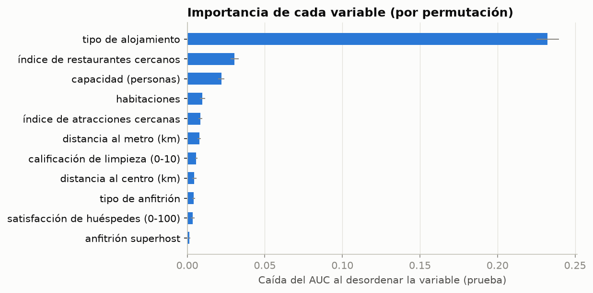
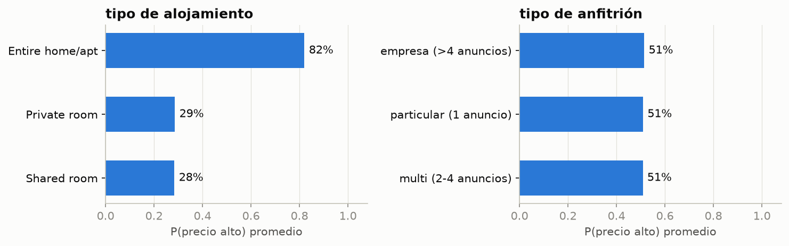
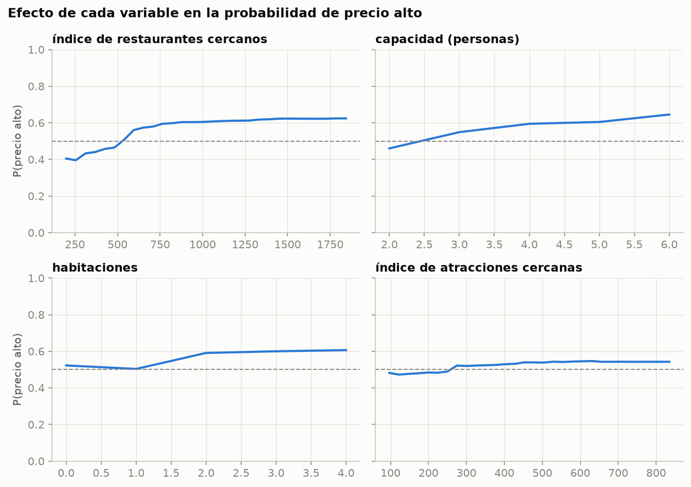
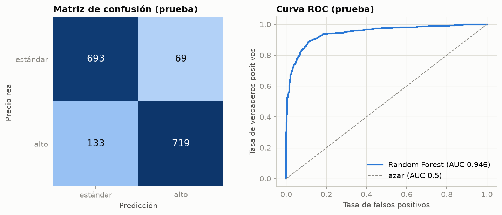

# Documento de hallazgos

**Para:** anfitriones de Airbnb en Londres y agencias que gestionan sus alojamientos
**Pregunta:** ¿Qué características de un alojamiento hacen que su precio de fin de semana quede por
encima de la mediana del mercado (€263 por estancia), para fijar el precio de un anuncio y decidir
en qué mejoras invertir?

Todas las cifras salen de la ejecución automática (`output/resumen_ejecucion.txt`) y se evaluaron
sobre **1 614 anuncios de prueba** que el modelo no vio durante su entrenamiento.

---

## 1. Respuesta corta

**El tipo de alojamiento decide casi todo. Después pesan la ubicación y el tamaño, y la calidad del
servicio apenas mueve el precio.**

| Factor | Efecto en la probabilidad de estar en la gama alta |
|---|---|
| **Vivienda completa** frente a habitación privada | **82 % frente a 29 %**. Es, de lejos, el factor más importante |
| **Zona con muchos restaurantes cerca** (zona céntrica) | De 40 % a 62 % |
| **Capacidad** de 2 a 6 personas | De 46 % a 65 % |
| **Habitaciones** de 1 a 2 o más | De 51 % a 59–61 % |
| Limpieza, satisfacción de huéspedes, ser *superhost* o tipo de anfitrión | Efecto casi nulo |

El modelo acierta en el **87.5 %** de los anuncios; adivinando al azar se acertaría alrededor del
50 %. Cuando dice que un anuncio es de gama alta, acierta el **91 %** de las veces.

## 2. Hallazgos principales

### 2.1 Vivienda completa o habitación: la primera decisión de precio

Si se desordena el tipo de alojamiento, el poder predictivo del modelo cae 0.23 puntos de AUC.
Ninguna otra variable supera 0.03.
- El **91 %** de las viviendas completas está por encima de la mediana (precio mediano: €446).
- Solo el **21 %** de las habitaciones privadas lo está (precio mediano: €181).

### 2.2 La ubicación y el tamaño son los siguientes factores

- **Restaurantes cercanos (`rest_index`):** la probabilidad de gama alta sube de 40 % a 60 % hasta
  un índice de unos 750, que corresponde al 25 % de anuncios más céntricos, y **luego se estanca**.
  Estar en una zona animada suma valor, pero estar en el centro exacto no suma más.
- **Capacidad:** cada persona adicional sube la probabilidad de forma constante, de 46 % con 2
  personas a 65 % con 6.
- **Habitaciones:** pasar de 1 a 2 habitaciones sube la probabilidad unos 8 puntos; a partir de
  ahí ya no sube más.
- La distancia al centro parece poco importante en el gráfico de importancia, pero es porque
  **comparte información con el índice de restaurantes** (correlación −0.75): ambos miden lo
  céntrico que está el anuncio.

### 2.3 La calidad del servicio no se traduce en precio

- La calificación de limpieza, la satisfacción de los huéspedes y ser *superhost* casi no cambian
  la predicción.
- De hecho, los *superhosts* tienen **menos** anuncios de gama alta (44 %) que el resto (52 %).
  Una buena reseña ayuda a conseguir reservas, pero **no justifica cobrar más** en este mercado.
- Tampoco importa si el anfitrión es un particular o una empresa con muchos anuncios: el efecto es
  51 % en los tres casos.

### 2.4 Dónde falla el modelo: las habitaciones privadas de gama alta

| Tipo | Anuncios en prueba | Realmente de gama alta | Exactitud del modelo | Gama alta que detecta |
|---|---|---|---|---|
| Vivienda completa | 739 | 91 % | 91.6 % | **99 %** |
| Habitación privada | 869 | 21 % | 84.0 % | **31 %** |

- El modelo es excelente separando viviendas de habitaciones.
- Pero de las **habitaciones privadas que sí se cobran caras, solo detecta 3 de cada 10**: 124 de
  los 133 anuncios caros que no detecta son habitaciones.
- Esas habitaciones de gama alta se distinguen de las demás por estar **más cerca del centro**
  (4.5 km frente a 6.3 km) y en **zonas con más restaurantes** (índice de 762 frente a 497). Aun
  así, el modelo no alcanza a reconocerlas bien con los datos disponibles.

## 3. ¿Qué tan confiables son estos resultados?

- **Alta capacidad de separar:** AUC de 0.946 en prueba, frente a 0.938 en validación cruzada. Son
  valores casi iguales, así que **el modelo no está sobreajustado**.
- **Estable frente a los parámetros:** las 10 mejores configuraciones del bosque difieren en menos
  de 0.002 de AUC.
- **Datos reales, pero de un solo momento:** provienen de un estudio académico con precios de fin
  de semana de una fecha concreta. No reflejan temporadas, eventos ni la evolución de los precios.
- **Faltan variables importantes:** no hay fotos, descripción, amenidades (como piscina o
  estacionamiento) ni ubicación exacta. Eso explica parte de los errores en las habitaciones
  privadas.
- **Asociación, no causa:** que los anuncios grandes sean más caros no significa que ampliar un
  alojamiento suba su precio automáticamente.
- **Precio total de la estancia:** `realSum` es el precio para 2 personas y 2 noches según el
  estudio original, no el precio por noche.

## 4. Recomendaciones

1. **Fijar la gama de precio empezando por el tipo de alojamiento.** Una vivienda completa en
   Londres compite en la gama alta (más de €263 por estancia de fin de semana); una habitación
   privada, en general no.
2. **Usar el modelo como primer filtro para viviendas completas,** donde acierta el 92 %. Si el
   modelo da menos de 50 % de probabilidad de gama alta a una vivienda completa, revisar si el
   precio actual está inflado. El 9 % de las viviendas completas son de gama estándar, y el
   modelo las confunde con caras.
3. **No usar el modelo para descartar habitaciones privadas.** Detecta solo el 31 % de las
   habitaciones de gama alta. Para una habitación privada **céntrica y en zona con muchos
   restaurantes**, comparar con anuncios similares de la zona antes de fijar un precio estándar,
   porque el modelo tiende a subestimarla.
4. **Priorizar las inversiones por su efecto en el precio:**
   - aumentar la capacidad (por ejemplo, un sofá cama: de 2 a 4 personas sube la probabilidad de
     gama alta de 46 % a 59 %);
   - pasar de 1 a 2 habitaciones.
   Mejorar las reseñas o conseguir el distintivo *superhost* ayuda a ocupar el alojamiento, pero
   no a subir el precio.
5. **Al elegir una propiedad para alquilar,** buscar zonas con oferta gastronómica alta (el índice
   de restaurantes por encima de 750). Más allá de ese punto, pagar más por estar en el centro
   exacto no se refleja en el precio.
6. **Para mejorar el modelo,** recolectar datos de amenidades, fotos y temporada, sobre todo de
   habitaciones privadas, que es donde más falla.

---

*Documento elaborado a partir de la ejecución del flujo automático. El detalle de cada cifra está
en `notebooks/evidencias_ea3.ipynb` y en `output/resumen_ejecucion.txt`.*
